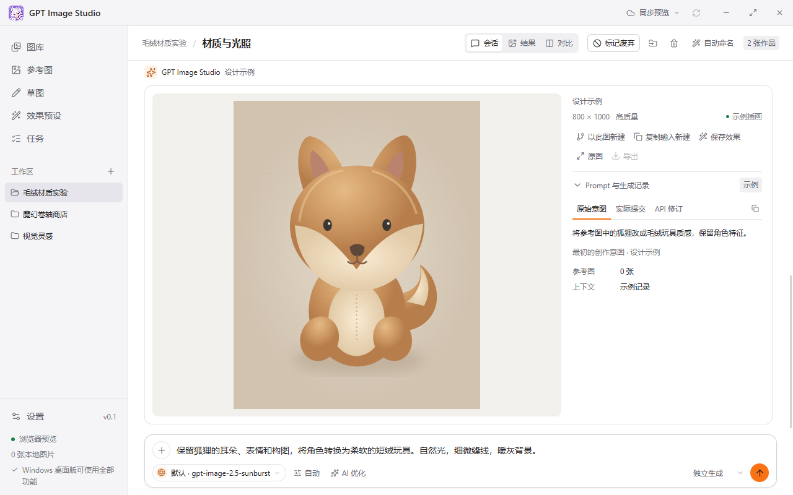

# GPT Image Studio

**创作 · 迭代 · 收藏**

面向 Windows 的本地 AI 图片创作工作台。将图片生成、多轮编辑、参考素材和作品管理放在同一个桌面应用中，让一个想法可以持续迭代，也让每张满意的作品都有迹可循。



## 为什么使用 GPT Image Studio

- **围绕项目组织创作**：用工作区和会话整理不同主题，生成结果、参考图与 Prompt 记录相互关联，方便继续创作和回看。
- **从生成走向持续迭代**：支持 Responses 多轮接续编辑，也能从已有图片派生新会话，尝试不同方向。
- **模型选择更自由**：同时配置多个 OpenAI 兼容提供商，为绘图、Prompt 优化和会话命名分别选择模型。
- **素材与成果保存在本机**：原图、预览和创作记录自动保存，数据目录可以自行选择，并支持迁移到其他磁盘。
- **为桌面看图与操作优化**：紧凑的底部输入区、完整显示的图片、并排对比和可缩放预览，让更多空间留给作品。

## 功能一览

### 图片生成与多轮编辑

- 支持 **Responses API** 与 **Images API**，可按所用服务选择调用方式。
- 在同一会话中接续上一轮结果继续编辑，或切换为独立生成。
- 支持文本描述、参考图输入、剪贴板粘贴图片，每次最多选择 8 张参考图。
- 输入区直接切换已配置的绘图模型，会话记住自己的选择，全局设置管理默认模型。
- 提供模型对应的尺寸、质量选项，支持相应模型的自定义尺寸。
- 用户消息展示本轮提交的参考图，点击可预览；左右切换限定在这条消息的参考图内。

### 工作区与作品管理

- 按工作区组织多个创作会话，支持工作区重命名。
- 工作区图库右上角可删除工作区：没有会话时直接删除；有会话时先显示会话数和去重后的参考图数，确认后删除会话及生成图，参考图全部保留。被其他会话或预设使用的生成图保留为参考素材，移除内容打包送入 Windows 回收站。
- 左侧按工作区列出入口，点击后集中浏览其中已生成的图片；点击图片卡片直接进入对应创作会话。
- 左侧工作区按住名称区域并移动 8 像素后可拖动排序，轻点仍打开工作区；顺序立即本地保存，并随自动同步或“立即同步”传到其他电脑（需使用支持排序的客户端）。聚焦工作区后也可用 Alt + 上下方向键调整。
- 可将会话移动到其他工作区，相关生成图片随会话迁移，共用参考图的引用会相应拆分。
- 工作区视图支持多选会话、全选当前筛选结果，批量移动或删除所选会话的全部版本。删除前显示会话、生成图与参考图数量；参考图保留，移除内容打包送入 Windows 回收站。批量操作一次提交，失败时保留原数据。
- 会话右上角可删除会话及未被共享使用的生成结果；仅此会话使用的参考图可选择同时移除，全局、其他会话或预设使用的图片保留。移除内容打包送入 Windows 回收站。
- 图库支持搜索、收藏、工作区筛选，默认按会话堆叠并展示最新图片，派生会话独立成组，也可切换为平铺。卡片使用会话标题。
- 图库与工作区可切换卡片、照片墙密铺两种展示模式，预览大小有小、中、大三档并记住选择。照片墙按原图比例密铺，右下角显示版本数和收藏状态，悬浮或键盘聚焦时显示会话标题。
- 参考图库集中管理素材，支持修改用于显示与搜索的逻辑名称，保留原图物理文件名。
- 选择参考图时，通过“全局参考图”“工作区参考图”和“生成图片”三个分页查找素材，支持按名称、Prompt、会话或模型搜索；切换分页保留关键词和已选图片。
- “以此图新建”将生成结果作为参考图新开会话；“复制输入新建”复制该结果的实际提交 Prompt、原参考图及生成参数，供修改后独立生图，点击时不会调用模型。也可保存效果预设以便复用。

### 迭代过程可回溯

- 每张生成结果保存原始创作意图、实际提交的 Prompt，以及服务返回的修订 Prompt（如有）。
- 模型、尺寸、质量、参考图和 Responses 上下文信息与结果一起保留。
- 提供会话、结果和对比视图，可并排比较两张作品及其 Prompt。
- AI 优化提供“优化（实验性）”，将抽象要求转为可见的动作、构图与光照，把场景组织成正在发生的瞬间；建议经过采用后才用于生成。
- Prompt 整理使用同一文本模型，仅按创作意图自动分类分行，直接替换输入框文本。
- 可使用语言模型自动命名会话，也可在创作过程中手动触发自动命名。

### 桌面图片查看与任务状态

- 图片预览支持滚轮缩放、拖拽平移、适应窗口、1:1 原始像素查看、旋转、全屏和导出。
- 支持左右切换图片，双击在适应窗口与 1:1 之间切换。
- 生图任务运行时显示 Windows 任务栏循环进度，任务在后台完成或失败时请求任务栏提醒。
- 任务运行期间可以切换页面，继续浏览和整理其他作品。
- 生成提示和任务列表实时显示已用时间，图片加载完成后保留从提交 Prompt 到图片可显示的总耗时，并随任务元数据同步；历史任务仅显示已有的生成与保存耗时。
- 支持浅色、深色、跟随系统主题和多种强调色。
- 在 **设置 → 网络** 中选择跟随系统、指定代理或直连，统一用于模型请求和图片下载；支持 HTTP / HTTPS / SOCKS5 / SOCKS5H、连接测试和已保存配置的连接路径查看。保存后对新任务生效。

### 手动导入 szurubooru 图库

- 在 **设置 → 图库** 保存 API 地址、用户名和 Token，选择支持视觉的标签模型（默认跟随 Prompt 优化模型）。Token 仅保存于 Windows 凭据管理器。
- 单张生成结果可直接选择“导入图库”；工作区多选后可确认具体图片与版本再批量提交，默认选择每个会话当前展示的图片。不会自动上传新生成的图片。
- **任务 → 图库导入** 显示批次及逐图进度，后台串行执行查重、读图打标与评级、上传原图和写入创作信息；标签调用计入用量统计。整个导入期间暂停多设备同步，图片生成仍可独立运行。
- 支持取消后续步骤、失败重试及重启后手动继续；复用已经生成的标签，并检查已上传帖子和评论，避免重复处理。已存在的原图只建立关联，不覆盖其标签或评论。
- 导入任务只在本机执行；成功后的帖子链接随图片元数据同步。正在导入时暂不允许删除、移动会话或迁移本地数据；关闭应用会中断导入，已上传图片保留。

### 多提供商与用量统计

- 支持配置 OpenAI、DeepSeek、OpenCode 及自定义 OpenAI 兼容服务。
- 提供商可分别管理服务地址、API Key 和模型列表，语言模型可选择 Responses 或 Chat Completions 协议。
- 图片主模型、默认绘图模型、Prompt 优化模型、会话命名模型可分别配置。
- 记录生成、优化和命名调用的 Token 用量，区分语言模型与图像模型的计费组成部分。
- 支持参考价格与自定义模型费率，保留调用时的价格快照，展示费用估算。
- 用量记录保存在 SQLite，并提供 JSONL 导出与采集格式，方便 Harness Scope 等工具接入。格式说明见 [用量日志与接入契约](docs/usage-format.md)。

## 开始创作

1. 启动桌面版，在 **设置 → 模型提供商** 中添加服务地址、API Key 和所需模型。
2. 在 **设置 → 通用** 中选择默认模型和图像调用方式。使用 Responses 生图时，需要同一提供商下支持 Responses 的语言主模型。
3. 新建工作区和创作会话，输入描述，按需粘贴图片或从素材库选择参考图。
4. 点击生成按钮，或按 **Ctrl + Enter** 提交。结果会自动保存到本地，可继续编辑、对比、收藏或导出。

图像模型、尺寸、质量和多轮编辑能力以所配置服务实际支持为准；添加兼容提供商并不代表其所有模型均支持图片生成。

## 数据与存储

- 原图、WebP 预览、SQLite 创作记录和用量日志保存在本机数据目录。
- 在 **设置 → 数据与存储** 中查看或更改目录；迁移会校验数据并在完成后重启应用。
- API Key 使用 Windows 凭据管理器保存，并绑定对应的提供商与服务地址。
- 调用模型时，相关 Prompt 和参考图会发送至你配置的服务。费用展示为参考估算，实际收费以提供商账单为准。
- 中断的生成任务不会自动重试，避免重复提交和计费。

## 本地开发与构建

基于 **Tauri 2 + React + TypeScript**。开发需要 Node.js / npm、Rust MSVC 工具链及 Tauri 的 Windows 开发依赖。

```powershell
npm ci
npm run desktop
```

构建 Windows 可执行文件：

```powershell
npm run desktop:build -- -- --locked
```

输出位置：`src-tauri/target/release/gpt-img-studio.exe`。

`npm run dev` 可预览界面；文件导入、持久化和模型调用需要桌面版。应用采用桌面宽窗口布局，默认窗口为 1280 × 800，最小为 1000 × 720 逻辑像素。

项目仍在快速迭代，目前以 Windows 为主要支持平台，暂未提供安装器、应用签名和自动更新。

## 开源协议

[MIT License](LICENSE)
